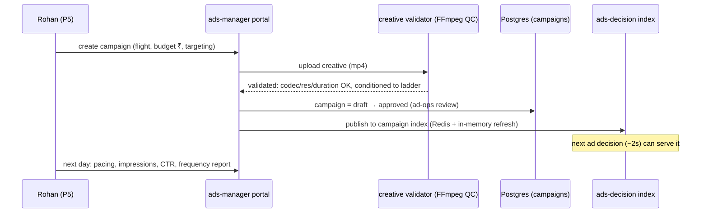

# 00-01 — Personas and User Journeys

Working name: **PravahPlay** · Phase 0 · 2026-10-29

## Personas

| # | Persona | Context | What success looks like |
|---|---|---|---|
| P1 | **Priya, 24** — casual viewer, free ad tier | Android Chrome, Mumbai commute, Hindi UI, price-sensitive | Signs up with phone OTP in <2 min, watches at 480p, tolerates pre-roll + limited mid-rolls, never pays |
| P2 | **Arjun, 34** — premium subscriber, sports superfan | TV-browser 10-foot UI + phone as second screen, IST prime time | Joins the live final at toss time with zero rebuffers, switches commentary EN↔HI, watches stats on phone |
| P3 | **Meera, 38** — family administrator | Manages 4 profiles, evening TV, downloads for kids' tablets | Creates kids profile with PIN + rating gate in <3 min; kids see only gated catalog, no ads |
| P4 | **Aarav, 8** — kids viewer | Tablet, big tiles, cannot read complex UI | Sees only age-gated content, huge thumbnails, no checkout paths, playback resumes where he left off |
| P5 | **Rohan, 29** — advertiser campaign manager (D2C brand) | Advertiser portal, weekly rhythm, ₹-budgets | Launches a campaign in 15 min, sees pacing/frequency/CTR next day, downloads an invoice |
| P6 | **Sana, 31** — platform content ops | CMS with review workflow, 3 languages | Ingests a title with metadata/artwork/trailers in en+hi+mr, schedules publish, sees it live on the home rail |
| P7 | **Vikram, 35** — live-event & SRE operator | On-call during match days, Grafana + runbooks | Executes pre-scale checklist, triggers ad-break cues, flips degradation ladders, runs chaos drills |

## Journeys (12)

| # | Journey | Persona | Phase exercised | Critical? |
|---|---|---|---|---|
| J1 | Signup with OTP → first frame < 30 s | P1 | 3, 5 | |
| J2 | **Match-day live join at toss** (spike, waiting room, token, first frame) | P2 | 8 | ★ |
| J3 | Kids profile + PIN + rating gate | P3/P4 | 3, 4 | |
| J4 | Download offline, resume on another device | P2/P3 | 5 | |
| J5 | Free → premium upgrade with coupon/trial | P1→P2 | 6 | |
| J6 | **Advertiser: campaign → creative → targeting → first report** | P5 | 7 | ★ |
| J7 | Content ingest → review → publish → home rail | P6 | 4, 5 | |
| J8 | **Live-event ops: pre-scale → spike → degradation ladder → recovery** | P7 | 8, 10 | ★ |
| J9 | Ad break in live (SCTE-style cue → SSAI cohort stitch → beacons) | P2/P5 | 7, 8 | |
| J10 | Renewal failure → dunning → grace → refund | P2 | 6 | |
| J11 | Voice/autosuggest search → filter → play | P1 | 4 | |
| J12 | Data export & account deletion (DPDP-style) | P3 | 3, 11 | |

## Critical journey sequences

### J2 — Match-day join (the spike)

```mermaid
sequenceDiagram
    participant V as Viewer (P2)
    participant CF as Cloudflare edge
    participant WR as Waiting room / admission
    participant GW as gateway-bff
    participant PB as playback svc
    participant AD as ads-decision
    participant CDN as CDN (segments)
    V->>CF: GET /live/final (page)
    CF-->>V: cached page + player
    V->>GW: POST /session/heartbeat + join live
    GW->>WR: admission check (concurrency budget)
    alt capacity available
        WR-->>GW: admitted
        GW->>PB: entitlement + device/stream limit check
        PB-->>V: signed short-lived manifest token
        V->>AD: ad decision (cohort key, break slot)
        AD-->>V: stitched pod (VAST/SSAI cohort manifest)
        V->>CDN: GET manifest + segments (cohort-cacheable)
        CDN-->>V: 1080p segments (99.9% cache hit)
    else over budget
        WR-->>V: queued position + ETA (jittered poll)
        Note over V,WR: playback never starts degraded; it starts when admitted
    end
```

### J6 — Advertiser campaign launch



### J8 — Live-event operations (degradation ladder)

```mermaid
sequenceDiagram
    participant S as Scheduler
    participant K as k3s / HPA-KEDA
    participant G as Grafana alerts
    participant O as Vikram (P7)
    participant U as Users
    S->>K: T-60min: pre-scale (replicas ×N, warm caches)
    G->>O: T-0: join spike beyond budget (burn-rate alert)
    O->>U: Ladder D1: disable reactions, personalization → static rails
    G->>O: still saturated (token path p99 > SLO)
    O->>U: Ladder D2: waiting room for new joiners; DVR window shortened
    G->>O: origin egress climbing (cache-hit drop)
    O->>U: Ladder D3: cap max bitrate to 720p cohort manifests
    Note over O,U: Never degraded: playback of admitted viewers, auth, token renewal
    G->>O: recovery: ladders reverse automatically on burn-rate recovery
```

## Journey-derived requirements (feed 00-02/00-03)

- J2 pins: admission control, cohort-SSAI cacheability, token p99, waiting-room UX.
- J6 pins: creative QC pipeline, approval workflow, index freshness ≤ 5 s, report latency ≤ 24 h.
- J8 pins: pre-scale runbook, per-feature kill switches (feature flags), burn-rate alerting,
  bitrate-cap ladder — all first-class Phase 8/10 features, not afterthoughts.
