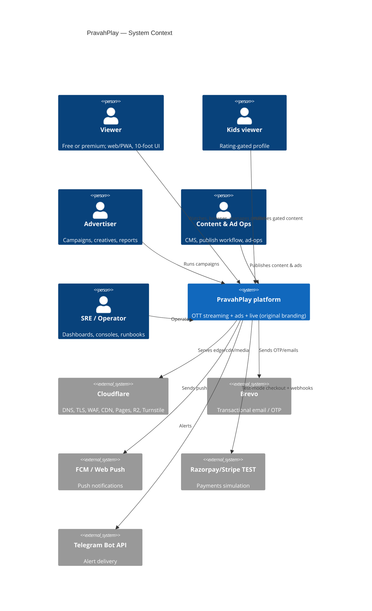
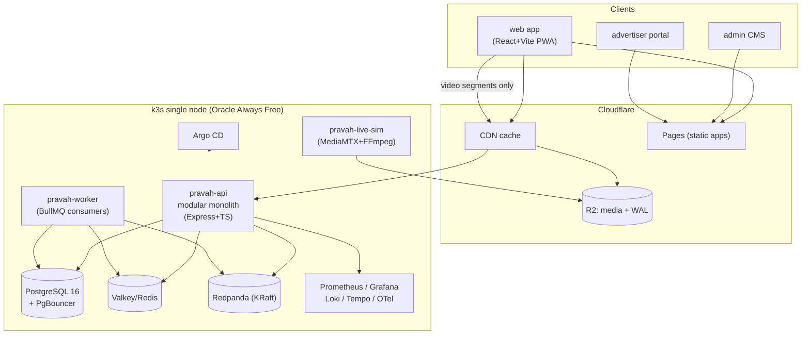

# 10-01 — C4 Architecture, Bounded Contexts, Service Boundaries

PravahPlay · Phase 1 · 2026-10-29 · Complements ADR-0003 (modular monolith first).

## Level 1 — System context

## Level 2 — Container view

**Delivery rule (ADR-0004):** player↔R2/CDN for all video bytes; `pravah-api` never proxies media.

## Bounded contexts → modules (one repo, one deployable + workers)

| Context | Module (`apps/api/src/modules/…`) | Owns (Postgres schema) | Key events published |
|---|---|---|---|
| Identity & access | `auth` | `auth` | `user.signup`, `auth.session.revoked` |
| Profiles & prefs | `profiles` | `profiles` | `profile.updated` |
| Catalog (system of record) | `catalog` | `catalog` | `title.published`, `title.updated` |
| Discovery & search | `discovery` | `discovery` (read models) | consumes `title.*`, `playback.progress` |
| Playback & entitlement | `playback` | `playback` | `playback.started`, `playback.heartbeat`, `playback.progress` |
| Subscriptions & payments | `billing` | `billing` | `entitlement.changed`, `payment.settled`, `invoice.issued` |
| Ads (decision/manager/tracker) | `ads` | `ads` | `ad.requested`, `ad.decided`, `ad.event` |
| Live & sports | `live` | `live` | `live.state.changed`, `score.updated`, `adbreak.cue` |
| Notifications | `notifications` | `notifications` | consumes most; sends email/push |
| Analytics ingest | `analytics` | `analytics` | consumes QoE/ad events; rollups |
| CMS & ad-ops (admin) | `admin` | `admin` (audit, workflow) | `cms.publish.approved` |

Boundaries enforced by CI (dependency-cruiser): modules import only their own schema repos, shared
packages, or other modules' public `api.ts` + event contracts — never their internals.

## Deployables (runtime)

| Deployable | Image | Contents | Scaling |
|---|---|---|---|
| `pravah-api` | node:22-alpine multi-stage | All modules, HTTP API, SSE endpoints | 1–2 replicas (RAM-bound) |
| `pravah-worker` | same image, worker entry | BullMQ consumers: media transcode dispatch, outbox relay, notification sender, analytics rollup, storage-budget job | 1 replica, concurrency capped |
| `pravah-live-sim` | ffmpeg + mediamtx | Simulated ingest, scoreboard generator (Phase 8) | 1 replica |
| frontends | static | Pages builds (web/admin/advertiser) | CDN |
| transcode jobs | k8s Jobs (FFmpeg) | per-title ladder (Phase 5) | 0–1 concurrent (RAM) |

Postgres/Valkey/Redpanda/observability run as in-cluster workloads (single node, no HA — accepted).

## Key request flows (edge → origin)

- Browse: `web → CDN (segment-keyed rails cache, 60–300 s TTL) → on miss pravah-api/discovery`.
- Play: `web → api/playback (token+manifest) → player → CDN/R2 segments`; heartbeats POST to api,
  land in Redis, batch-flushed to PG; progress events → Kafka → discovery read model.
- Ads: decision path in-process (in-memory index) with 2 s cohort response cache; beacons →
  `/ads/t` (tracker) → Kafka → rollups.
- Live join: admission control at gateway (Redis counter) → token → cohort manifest (CDN-cached).
