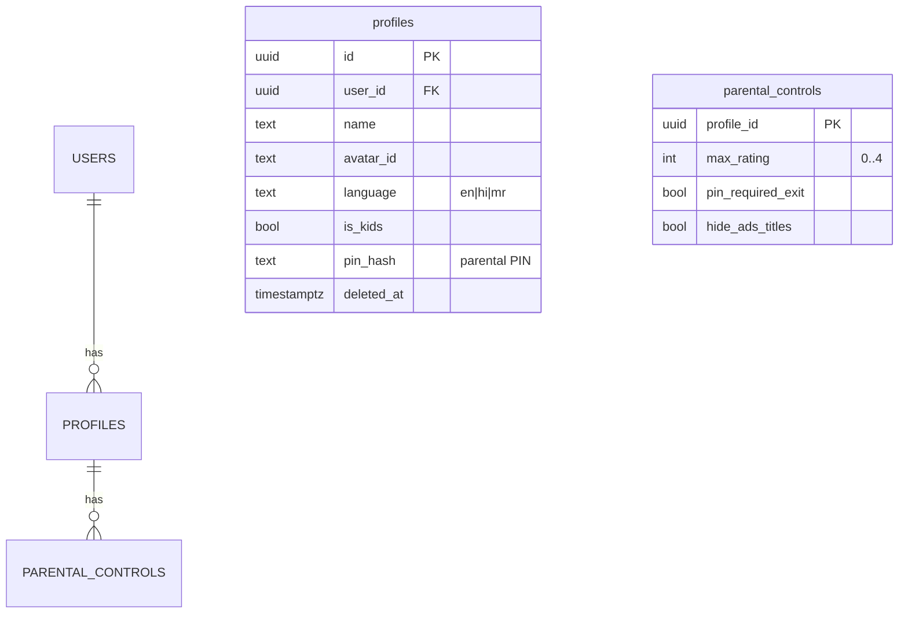
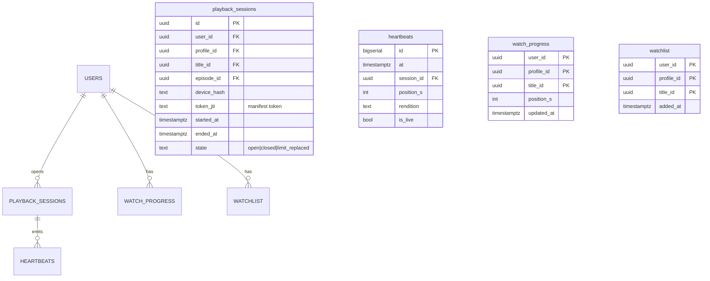
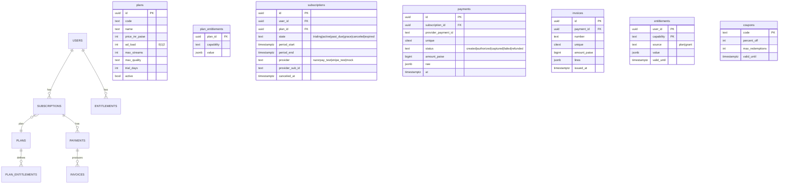

# 10-02 — Data Models (ERDs, Indexes, Partitioning, Retention)

PravahPlay · Phase 1 · 2026-10-29 · Postgres-only per ADR-0002. One database, schema-per-module.
All tables: `id uuid pk default gen_random_uuid()`, `created_at`/`updated_at timestamptz` unless
noted. Migrations via drizzle-kit (ADR-0011), raw SQL for partition/extension DDL.

## auth schema

```mermaid
erDiagram
    USERS ||--o{ AUTH_IDENTIFIERS : has
    USERS ||--o{ SESSIONS : has
    SESSIONS ||--o{ REFRESH_TOKENS : has
    USERS ||--o{ AUDIT_LOG : generates
    users { uuid id PK timestamptz created_at text status "active|suspended|deleted" timestamptz deleted_at }
    auth_identifiers { uuid id PK uuid user_id FK text type "email|phone" text value citext text hashed_otp timestamptz otp_expires_at int otp_attempts timestamptz verified_at }
    sessions { uuid id PK uuid user_id FK text device_hash text ua jsonb device_meta inet last_ip timestamptz last_seen_at timestamptz revoked_at }
    refresh_tokens { uuid id PK uuid session_id FK text token_hash uuid predecessor_id "rotation chain" timestamptz expires_at bool reused_flag }
    audit_log { bigserial id timestamptz at uuid actor_user_id text action jsonb detail inet ip }
```

- Indexes: `auth_identifiers (type, value)` unique; `sessions (user_id, last_seen_at desc)`;
  `refresh_tokens (token_hash)` unique; `audit_log (actor_user_id, at desc)` BRIN on `at`.
- Retention: OTP fields nulled after use (codes live ≤15 min); sessions pruned 180 d inactive;
  audit_log partitioned monthly, kept 12 months (then archived to R2 JSONL).
- Turnstile token + IP rate-limit counters live in Redis only.

## profiles schema



- Max 5 profiles/user (DB constraint). Kids profile: `is_kids` + mandatory `parental_controls`.
- Rating scale (original, 0..4): U / U-7+ / U-13+ / A-16+ (see 00-07).

## catalog schema

```mermaid
erDiagram
    TITLES ||--o{ SEASONS : has
    SEASONS ||--o{ EPISODES : has
    TITLES ||--o{ TITLE_LANG : localized
    TITLES ||--o{ AVAILABILITY : gated_by
    TITLES }o--o{ PEOPLE : credits
    TITLES ||--o{ ASSETS : has
    TITLES ||--o{ CATALOG_EVENTS : emits
    titles { uuid id PK text kind "movie|series|episode_ref|live_channel|sports_event" text slug citext unique text rating_class int advisory jsonb text license "cc-by-3.0|cc0|self-made" text credit_url jsonb metadata_ext "JSONB flexible" text status "draft|in_review|published|archived" timestamptz published_at }
    title_lang { uuid title_id FK text lang text name text synopsis text tagline PK(id,lang) }
    seasons { uuid id PK uuid title_id FK int number }
    episodes { uuid id PK uuid season_id FK int number int duration_s uuid media_asset_id FK }
    availability { uuid title_id FK text region "IN" timestamptz window_start timestamptz window_end text rights_note }
    assets { uuid id PK uuid title_id FK text type "poster|hero|trailer|thumb_sprite|subtitle|audio_track" text r2_key text lang text license }
    catalog_events { bigserial id PK timestamptz at uuid title_id text kind jsonb payload }
```

- Indexes: `titles (status, kind, published_at desc)`; trgm index on `title_lang.name` for typo-
  tolerant search; FTS `tsvector` generated column (name+synopsis) GIN-indexed per lang.
- `catalog_events` feeds the outbox relay (ADR-0007). Publishing workflow states in `status` +
  admin review table.
- Retention: soft archival only (catalog is small); `assets.r2_key` subject to the storage-budget
  job (ADR-0004).

## playback schema



- `heartbeats` partitioned **daily** via pg_partman (S2 spike sizes this), raw kept 14 d, then
  aggregated into `watch_progress` + `analytics.playback_daily` and dropped.
- `watch_progress` PK (profile_id, title_id) — upsert on heartbeat flush (5 s batch).
- Concurrency enforcement: Redis counter per user (active sessions), PG is fallback truth.

## billing schema



- Webhook idempotency: `payments.provider_payment_id` unique + `billing.webhook_events` dedup
  table (provider event id citext unique).
- Dunning state machine fields on `subscriptions.state` + `dunning_attempts` table (attempt no,
  next retry, backoff).
- Retention: keep all (small volume, financial record); test-mode banner on invoices.

## ads schema

```mermaid
erDiagram
    ADVERTISERS ||--o{ CAMPAIGNS : has
    CAMPAIGNS ||--o{ FLIGHTS : has
    FLIGHTS ||--o{ CREATIVES : uses
    CAMPAIGNS ||--o{ TARGETING : has
    CREATIVE_EVENTS }o--|| CREATIVES : about
    advertisers { uuid id PK text name text contact_email text status }
    campaigns { uuid id PK uuid advertiser_id FK text name text goal "awareness|reach|conversion" bigint budget_paise text pacing "even|afap" text status "draft|pending_review|approved|paused|completed" }
    flights { uuid id PK uuid campaign_id FK timestamptz start timestamptz end bigint daily_cap_paise int frequency_cap_per_user_day }
    creatives { uuid id PK uuid flight_id FK text r2_key int duration_s text codec text resolution text clickthrough_url text qc_status "pending|passed|failed" jsonb qc_report }
    targeting { uuid flight_id PK jsonb rules "geo,lang,device,genre,live,cohort,daypart" }
    creative_events { timestamptz at PK uuid creative_id FK text type "impression|start|q1|mid|q3|complete|click|skip|error" text cohort text user_bucket "pseudonymous" text beacon_id citext }
```

- `creative_events` partitioned **daily**; raw 30 d → rollups (`ads.hourly_stats`), then dropped.
- In-memory decision index (campaign/flight/creative, targeting rules, freq/pacing from Redis)
  rebuilt every 5 s from PG; decisions also cached 2 s per cohort+break-slot.
- Dedup: `beacon_id` citext unique per (creative_id, session) — idempotent beacons.

## live schema

```mermaid
erDiagram
    CHANNELS ||--o{ EPG_ENTRIES : has
    SPORTS_EVENTS ||--|| CHANNELS : "on"
    SPORTS_EVENTS ||--o{ SCORE_UPDATES : emits
    SPORTS_EVENTS ||--o{ COMMENTARY : has
    channels { uuid id PK text slug citext unique text lang jsonb dvr_window_min }
    epg_entries { uuid channel_id FK timestamptz start timestamptz endc uuid title_id FK text label PK(channel_id,start) }
    sports_events { uuid id PK text name text teams jsonb timestamptz start_at text state "scheduled|live|break|ended" text r2_key "loop source" }
    score_updates { bigserial id PK timestamptz at uuid event_id FK int seq jsonb score jsonb stats }
    commentary { bigserial id PK timestamptz at uuid event_id FK text lang text text }
```

- `score_updates`/`commentary` partitioned daily, 7 d retention (source of truth for match center
  is the live feed; history aggregates kept).

## analytics schema

- `qoe_events` partitioned daily (startup_ms, rebuffers, bitrate, errors; session-sampled), 90 d.
- `playback_daily`, `ads.hourly_stats`, `audience_daily` (DAU/MAU via HLL sketches in Redis +
  daily PG rollup), `funnels` (event-funnel materialized view).
- Ingest: client → `/analytics/collect` (batched) → Kafka `analytics.events` → consumer → PG.

## discovery schema (read models / CQRS)

- `rails` (editorial config), `trending_zset_mirror` (from Redis), `search_titles` (materialized
  FTS+trgm view), `co_watch_pairs` (item-item counts, pgvector `title_embeddings` for similarity).
- Rebuilt via events (`title.*`, `playback.progress`, hourly trending jobs). Rebuildable = no
  backup requirement beyond source events.

## Redis keyspace (per ADR-0006)

| DB | Role | Keys (TTL) |
|---|---|---|
| 0 | sessions + rate limits | `sess:{id}` (30 d sliding), `rl:{route}:{ip|user}` (60 s) |
| 1 | API response cache | `cache:{module}:{key}` (30–300 s) |
| 2 | BullMQ | queues: `media`, `notify`, `outbox`, `rollup` |
| 3 | counters/HLL | `conc:{user}` (stream TTL), `live:ccv` HLL, `ads:freq:{user}:{campaign}:{day}` (36 h) |
| 4 | trending/rails | `trend:{lang}:{window}` ZSETs, `segment:{cohort}` rails snapshots |

## Kafka topics (per ADR-0007; AsyncAPI in 10-03)

`user.events`, `catalog.events`, `playback.events`, `billing.events`, `ad.requests`, `ad.decisions`,
`ad.events`, `live.events`, `analytics.events`, `notifications.requests`, plus `outbox.relay`
internal. Partition counts: user-keyed topics 3; analytics 6; rest 1 (single node).
