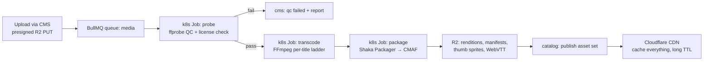

# 10-05 — Video Pipeline Design (ingest → transcode → package → DRM → CDN)

PravahPlay · Phase 1 · 2026-10-29 · Implements ADR-0008; constrained by ADR-0004 (10 GB R2).

## Pipeline stages

1. **Upload**: CMS requests a presigned R2 PUT (browser → R2 direct; API never proxies bytes).
   On complete, `media` job enqueued (outbox event).
2. **Probe/QC job**: ffprobe JSON → validate codec/duration/aspect; license metadata mandatory
   (00-07) or reject. Report stored on title.
3. **Transcode job** (FFmpeg): per-title ladder decided from source (brief: ladder ≈
   360p@0.8 / 480p@1.2 / 720p@2.5 / 1080p@4.5 Mbps, AAC-LC 128k stereo; Hindi + EN audio tracks
   where source provides). Demo catalog is curated (00-04 §5) so 1080p only for flagship titles.
   Progress via BullMQ job events → CMS progress bar.
4. **Package job**: Shaka Packager → fMP4 CMAF; outputs HLS master+media playlists and DASH MPD
   from one rendition set; trick-play sprites (1 fps thumbs), WebVTT subs, multi-audio; ClearKey
   content keys (AES-128 for HLS, cenc for DASH) generated per title, stored in `playback.keys`
   (API-only access).
5. **Register**: asset rows in `catalog.assets` with r2_keys; publish flips title status.
6. **CDN**: `Cache-Control: public, max-age=31536000, immutable` on segments (content-hashed
   names); manifests short TTL (60 s VOD, 2 s live cohorts); signed playback manifest endpoint
   resolves tokens → relative segment URLs.

## Offline downloads (Phase 5)

Service worker + Cache API/OPFS: player fetches segments via SW → cached under title-scoped cache;
license = ClearKey with expiry enforced client-side + session re-validation on expiry (honest
limitation: client-side enforcement only at zero-cost DRM); downloads count toward concurrency.

## Failure handling

| Stage | Failure | Handling |
|---|---|---|
| Upload | incomplete/interrupted | presigned expiry; multipart cleanup job |
| Probe | corrupt/undecodable | QC failed, no downstream jobs |
| Transcode | OOM (1080p) | k8s Job resource limits; retry ladder capped to 720p (flagged to ops) |
| Package | manifest mismatch | job fails atomically; no partial publish (staging prefix, atomic R2 copy) |
| Publish | half-written set | staging-prefix + manifest-first publish; verify-all-HEAD before flip |
| CDN | origin misses | request coalescing at edge; origin shield behavior verified in Phase 10 |

## Storage accounting hooks

Storage-budget job (worker): sums `catalog.assets` bytes vs 10 GB cap; blocks new transcode jobs at
90%; alerts 80%. Deleting a title deletes R2 objects first (receipts), rows after — never orphaned
objects beyond 24 h.
