# 10-06 — Ads Architecture (decision, CSAI/SSAI, tracking, fail-open)

PravahPlay · Phase 1 · 2026-10-29 · Implements brief §9 and ADR-0008.

## Decision pipeline (ads module, in-memory index)

```mermaid
flowchart LR
    REQ[ad request<br/>cohort + breakSlot + podDurationS] --> ELIG[eligibility filter<br/>flight dates, budget, status]
    ELIG --> TGT[targeting match<br/>geo,lang,device,genre,live,cohort,daypart]
    TGT --> FREQ[frequency cap<br/>Redis per user×campaign×day]
    FREQ --> PAC[pacing check<br/>even vs AFAP, daily budget]
    PAC --> RANK[auction: direct-sold first<br/>then 2nd-price mock OpenRTB bidders<br/>strict 50 ms timeout]
    RANK --> SEP[competitive separation<br/>+ brand safety]
    SEP --> POD[ad pod construction<br/>duration, count, skip rules]
    POD --> RESP[VAST 4.x / VMAP + cohort manifest refs]
```

- **Index**: campaigns/flights/creatives/targeting loaded into memory every 5 s (PG → module);
  freq/pacing counters in Redis. Decision p99 < 50 ms budget (SLO 00-03); 2 s response cache per
  (cohort × breakSlot).
- **Mock bidders**: 2–3 in-process OpenRTB 2.6-shaped bidders with seeded random yields —
  demonstrate auction mechanics with zero external demand.
- **Fail-open law**: any timeout/exception ⇒ serve content without pod; ad failure must never block
  video (enforced by circuit breaker + chaos test in Phase 7/10).

## Client-side (CSAI) vs server-side (SSAI)

| | CSAI (VAST in player) | SSAI (cohort stitching) |
|---|---|---|
| Use | VOD pre/mid/post on free tier; pause ads | Live breaks; premium-light mid-rolls; scaled VOD |
| Caching | n/a (player-side) | cohort manifests 2 s TTL; ad segments immutable |
| Ad-blocker exposure | vulnerable | resistant |
| QoE | visible switch | seamless (conditioned renditions) |

**Cohort stitching (ADR-0008)**: viewers bucketed by (plan × region × adLoad × maxQuality) → small
cohort set; stitcher maintains per-cohort playlist variants: content segments + pod segments with
`#EXT-X-DISCONTINUITY` + `#EXT-X-DATERANGE` (SCTE-35-style cue → DATERANGE mapping: `planned-duration`,
`SCTE35-OUT` placeholder hex from cue console); renditions conditioned so no player re-init.

## Tracking

- Server-side beacons preferred: stitcher logs impression/start/quartiles from manifest position
  math; client sends click/skip/error via `POST /v1/ads/t/{beaconId}/{type}` (204, no-store).
- Idempotency: beacon_id unique; Kafka topics `ad.requests/decisions/events`; consumers: rollup
  (PG `ads.hourly_stats`), pacing/frequency updates (Redis), reconciliation job (tracker counts vs
  decision logs; drift > 2% alerts).
- IVT basics: rate-limit per IP/device, duplicate-beacon suppression, impossible-speed completion
  filter, cohort consistency checks.
- Privacy: pseudonymous `user_bucket` (salted hash, rotated daily); no cross-site tracking.

## Ad ops surfaces

- Advertiser portal (Phase 7C): campaign CRUD, creative upload+QC (reuse media pipeline probes),
  approval workflow (ad-ops RBAC), targeting/budget setup, reports (impressions, reach, frequency,
  CTR, VTR, fill, eCPM, spend), simulated invoices.
- Ops console: blackout windows, ad-load per plan/event, live cue trigger (10-07), kill switch:
  `ads.enabled=false` ⇒ global fail-open.
